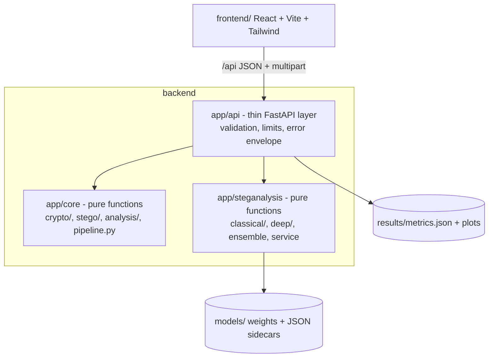
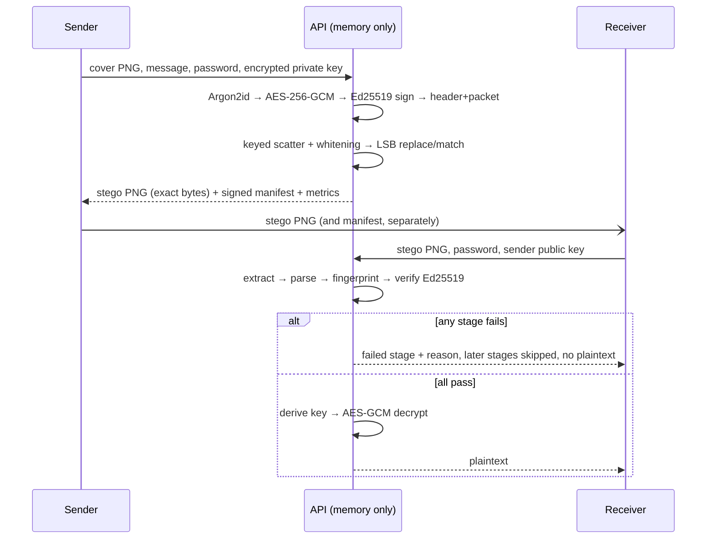
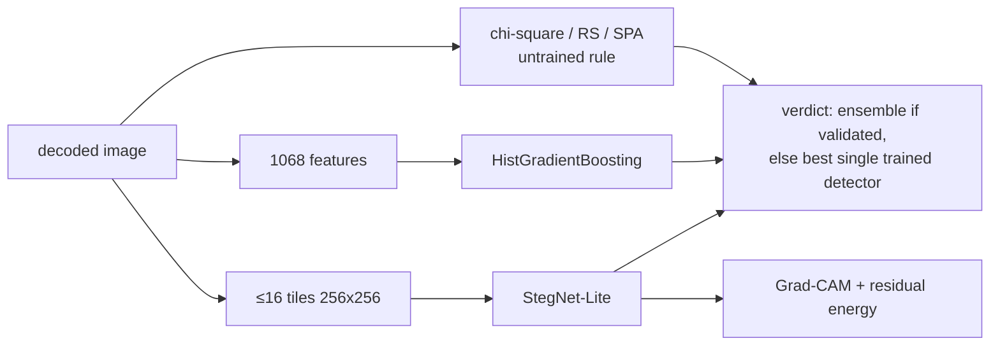

# Architecture

## Layers

**Rule:** `core/` and `steganalysis/` never import FastAPI. `api/` only validates input, calls them, and maps
exceptions to error codes. This keeps tests fast and every function explainable.

## Sender and receiver flow

## Stego stream and packet

- **Adaptive message embedding.** `/embed` supports real S-UNIWARD and HILL using their cost maps and STC. The
  `/extract` decoder recovers the embedded packet from the image without needing the cover or cost map.
- **Simulator distinction.** `core/stego/simulate.py` still creates entropy-matched S-UNIWARD and HILL changes for
  detector experiments. Those outputs carry no message; stored detector results do not measure real STC embeddings.

- Stream = 13-byte header (`SGST`, version, length, CRC32) ‖ packet. In keyed mode a random 16-byte salt sits
  in the LSBs of the first 128 samples; the rest are scattered by a ChaCha20-derived permutation and whitened.
- **Techniques.** `lsb_replace` and `lsb_match` write one bit per sample; `lsb2_replace` writes two (first bit in
  bit 1, second in bit 0), doubling capacity. S-UNIWARD and HILL use their additive costs with STC. `extract_auto`
  tries 1-bit LSB, 2-LSB and the STC frame; the common header CRC rejects wrong guesses.
- **Simulators (detection testing only).** `core/stego/simulate.py` reproduces where S-UNIWARD and HILL would change an
  image (cost map + entropy-matched ±1 probabilities). They carry no message and supply the saved detector rows.
  Real STC messages are supported by Hide, but detector performance on them has not been measured.
- Packet = 128 bytes of overhead + plaintext (magic, version, flags, kdf id, sender fingerprint, salt, nonce,
  ciphertext length, ciphertext with GCM tag, Ed25519 signature over everything before it).
- Details and rationale: PROJECT_BLUEPRINT.md §6; code in `app/core/stego/` and `app/core/crypto/packet.py`.

## Detection flow

`app/steganalysis/service.py` loads whichever models exist at startup. A missing or corrupt model disables only
itself and is reported in `GET /api/models`; the UI labels it "not trained". The ensemble weights and operating
thresholds come from `models/ensemble.json`, written by `scripts/evaluate.py` from **validation** data only.

## State and limits

- No database, no disk writes. Starlette's multipart spool threshold is raised above the request cap so uploads
  never spill into temp files.
- Request body cap 10 MB per file (checked from `Content-Length` and while streaming), pixel limits read from the
  image header before decoding, Pillow decompression-bomb guard, 30 POST/min/IP sliding-window limiter with
  `Retry-After`.
- Responses carry `X-Content-Type-Options`, `Referrer-Policy`, `Cache-Control: no-store`, and a deny-all CSP.
  The nginx image adds a strict CSP for the SPA.

## Reproducibility

| Stage | Command (from `backend/`) |
|---|---|
| Prepare dataset | `python -m scripts.prepare_dataset --src data/raw/BOSSbase_1.01 --out data/bossbase-prepared` |
| Train classical | `python -m scripts.train_classical --dataset data/bossbase-prepared` (needs `STEGAGUARD_TRAINING_PASSPHRASE`) |
| Train CNN | `python -m scripts.train_cnn --dataset data/bossbase-prepared --device cuda --num-workers 5 --fixed-workers 4` |
| Mismatch CNN | same, plus `--train-methods lsb_replace --model-name cnn_mismatch_replace` |
| Evaluate | `python -m scripts.evaluate --fixed data/cnn-fixed` |
| Run app | `uvicorn app.main:app` and `npm run dev` in `frontend/`, or `docker compose up --build` |

All randomness is seeded (default 1337); fixed validation/test sets are regenerated bit-identically from the
seed, and `metrics.json` records a hash over their manifests.
